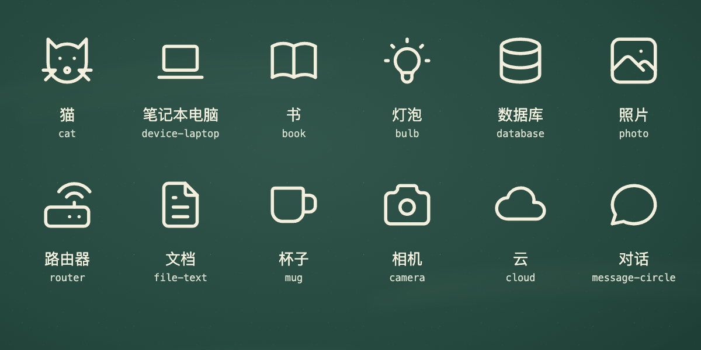

# 板书配图

「电脑怎么认猫」可以这样讲：正面的猫出现，老师说到胡须才圈出胡须。说到转身，再补一只相同花纹的猫背影，让学生亲眼发现这条规则漏掉了什么。普通对象用一个图标就够；需要解释变化时，同一对象保留在原位，逐步添加对照。画面下方留给旁白字幕。

## 随包图形



上面 12 个图形的路径来自 Tabler Icons，使用时按笔画长度逐步显现。[上游版本](https://github.com/tabler/tabler-icons/tree/e8fcec66034d15fa893d4d3c740e584f8518ed44/icons/outline) · [逐项来源](../assets/starter/public/chalk/TABLER-SOURCE.txt) · [MIT 许可证](../assets/starter/public/chalk/TABLER-LICENSE.txt)

| 原创教学图名 | 黑板上发生什么 |
| --- | --- |
| `cat-front`、`cat-back` | 同一只坐着的猫保留耳形和尾纹，正面能看到眼睛、鼻子和胡须，转身后只见背影。 |
| `chess-search` | 8 × 8 国际象棋盘上，马从 c3 可以跳到 d5 或 e4。两个候选格依次标出。 |
| `go-search` | 十九路围棋盘上，黑白子落在交叉点。画完局部棋形，圈出一个候选点。 |

两张棋盘用于演示搜索概念。要说明历史比赛的具体一手，应查比赛棋谱、按对应局面绘制，并在图注中标明局次与手数。[28 秒动态示范](../assets/board-illustrations-preview.mp4)在 Remotion Studio 中对应 `FigureLesson`。

## 配到解说词里

在 `assets/starter/script/board.json` 找到解说词对应的 `scene/phase`。下例是 `marks` 中的一笔，在该拍第 12 帧开始画猫，第 52 帧完成，随后整张图留下。板书坐标为 1280 × 720，`x`、`y` 表示图框左上角，`size` 为边长。圈线和下一句的字继续使用同一页。[节拍、留板与擦除](production.md)

```json
{"kind":"figure","name":"cat-front","x":180,"y":150,"size":320,"frames":[12,52]}
```

替换 `name` 就能换图。图形与书写可共用一条时间轴，也可以用 `"volume": 0` 让某次出图静音。给复杂棋盘留足辨认时间，等格子或线画好，再给观众看候选位置。

## 使用自己的图片

需要展示真实外观或原始资料时，把有权使用的图片放进工程的 `public` 目录。例如把照片放到 `public/illustrations/cat.jpg`，在目标拍的 `marks` 中加入下面一项。图片按原宽高比在指定框内淡入，同页保留并随板擦除。交付可编辑工程时，连同图片及其作者、来源、适用许可一起打包。

```json
{"kind":"image","src":"illustrations/cat.jpg","alt":"从身后拍摄的猫","x":670,"y":165,"width":370,"height":305,"frames":[8,22]}
```

以后需要棋谱回放或交互演示时，国际象棋可参考 chessboard.js，围棋可参考 Sabaki 的 Shudan。随包的教学棋盘用本地 SVG 绘制。[chessboard.js](https://github.com/oakmac/chessboardjs) · [Shudan](https://github.com/SabakiHQ/Shudan)
